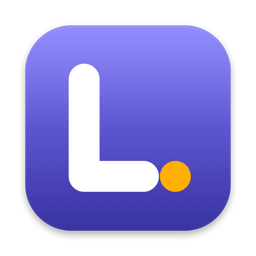

<p align="center"></p>

# Lex

A personal Grammarly for macOS that works in every app. It checks what you type as you type, refines a sentence the moment you finish it, and translates, summarizes, reads aloud and takes dictation, all from the keyboard. There's an [iPhone app](#lex-on-iphone) too.

## Install

```bash
curl -fsSL https://raw.githubusercontent.com/matanweks/Lex/main/scripts/install.sh | bash
```

This builds Lex on your Mac (about a minute), installs it in `~/Applications` and opens it. Look for the **L.** in your menu bar. A setup guide then walks you through the rest:

1. **Allow Accessibility**, so Lex can read and fix text in other apps.
2. **Add your Anthropic API key.** It stays in your Keychain.
3. Optional: the microphone and Input Monitoring for dictation, and a Google Cloud sign-in for natural voices and Hebrew dictation.

You need macOS 14 or later and Apple's Command Line Tools 26 or later; the installer offers to install them. Run the same command to update; your settings and key are kept. To open the guide again, choose **Setup Guide…** from the Lex menu.

To uninstall, quit Lex and delete `~/Applications/Lex.app`. To remove its settings too, run `defaults delete dev.lex.app` and delete the `dev.lex.app` items in Keychain Access.

## Shortcuts

| Shortcut | What it does | Works on |
|---|---|---|
| **⌃1** | **Refine**: a better version of what you wrote, with ↵ to put it in | The sentence you just finished, or the selection |
| **⌃2** | **Translate** between Hebrew and English | The selection, or the sentence you're in |
| **⌃3** | **Summarize & reply**: a summary, key points, a drafted reply | Selected text anywhere (an email, a thread, a page) |
| **⌃4** | **Tone check**: how your message will land, plus a better-toned version | The message you're writing, or the selection |
| **⌃§** | **Fix all**: applies every correction in the field at once | The field you're typing in |
| **⌥§** | **Read aloud**; press again to stop | The selection, or the paragraph at the cursor |
| **⌃⌘V** | **Clipboard history**: search what you copied, paste it again | Any app |
| Hold **Right ⌥** | **Dictate**: talk, let go, and the text is typed at your cursor | Any text field |
| Double-tap **Right ⌥** | **Hands-free dictation**; tap once more to finish | Any text field |
| Select text, hold **Right ⌥** | **Voice edit**: say what to change ("make this friendlier") | The selection |
| Type a trigger and a space | **Snippet**: `;cal ` becomes your saved text | Any text field Lex checks |
| **esc** | Cancels dictation, or closes a panel | |

§ is the key left of 1 on ISO keyboards. Every shortcut can be changed in Settings, and each one is also in the menu-bar menu. ⌘-drag the Lex icon to move it in the menu bar; it keeps that spot.

### Inside the panel

The panel that ⌃1, ⌃2, ⌃3 and ⌃4 open streams its answer as it's written.

| Key | In your own text (⌃1, ⌃2, ⌃4) | On someone else's text (⌃3, or ⌃2 outside a text field) |
|---|---|---|
| **↵** | Replaces the text in place | Copies the result |
| **⌘1–8** / **⌘1–4** | Improve, Fix only, Shorter, Clearer, Friendlier, Formal, Direct, Translate | Summary, Key points, Draft reply, Translate |
| Type, then **↵** | Applies your own instruction ("less salesy") | Reworks the result ("shorter, and in Hebrew") |
| **Tab** | Switches scope: sentence, paragraph, whole field | |
| **⌘Z** · **⌘C** · **⌘D** | Undo a step · copy · show or hide the changes | Undo a step · copy |
| **esc** | Closes the panel | Closes the panel |

## Features

### Checking as you type

- **Instant layer:** macOS's own spelling and grammar checker runs on every keystroke, offline, in a few milliseconds.
- **Claude layer:** each sentence goes to Claude Haiku 5.5 the moment you finish it (`.` `!` `?` or a line break), or after a 0.7-second pause on a longer unfinished sentence.
  - **Fast:** Claude answers one line per fix, streamed, and each underline appears as its line arrives (about 1 s). The prompt is cached.
  - **Cached per sentence:** results are stored by sentence text, so editing one sentence never re-checks the others.
  - **No flicker:** while you edit a sentence, its existing underlines stay up until the re-check returns.
  - **Authoritative:** once Claude has reviewed a sentence, the spell checker's flags on names and jargon there are cleared.
- **Fixing:** hover an underline to see the fix and apply it with a click, ignore it, or add the word to your dictionary. In message boxes and other small fields, the card opens above or below the field so it never covers your text. A click that lands just as the card appears is ignored, and clicking anywhere else dismisses it.
- **Badge:** a small badge next to the field shows the issue count. Clicking it refines the whole field.

### Refine (⌃1)

A panel streams a rewrite from Claude Sonnet 5.5 (changeable in Settings), with the changes highlighted. Each preset stacks on the current version, so "Shorter" then "Friendlier" does both. With a selection, ⌃1 refines the selection.

### Fix all (⌃§)

- **What's included:** spelling, grammar, punctuation and word choice. Clarity rewrites stay manual. The word you just typed counts too.
- **Accuracy:** Lex first has Claude check any sentence it hasn't reviewed, waiting up to 2.5 s, so a name only the spell checker flagged isn't "fixed".
- **How fixes go in:** fixes are applied one by one from the end of the text, so formatting such as @mentions survives. Each waits until the app has taken the previous one, and your clipboard is saved and restored once for the whole batch.
- **Your cursor stays put:** afterwards the cursor goes back where you were typing, moved along by any fixes before it.

### Translate (⌃2)

Translates between Hebrew and English: Hebrew text goes to English, anything else to Hebrew. In a field you're writing in, it works on the selection or the sentence you're in, and ↵ replaces it. Anywhere else (a web page, an email you're reading), it works on the selection and ↵ copies the translation.

### Summarize & reply (⌃3)

Select an email, thread or page and press ⌃3 for a summary of what it's about, what's asked and any deadline. **⌘2** lists the key points with a "To do:" line, **⌘3** drafts a reply as you (unknown facts go in [brackets]), and **⌘4** translates it. ↵ copies the result; nothing is written over the original. With nothing selected in a text field, the whole field is used.

### Tone check (⌃4)

Press ⌃4 in a message you're writing. In two lines, Claude says how the reader will likely take it and names the biggest risk. Next to that is a version with a better tone, keeping your content, which ↵ puts in. Without a selection it reads the whole message.

### Read aloud (⌥§)

- **Source:** the selection comes through Accessibility, or by copying it (web pages, PDFs, Mail) and then restoring your clipboard. With nothing selected in a text field, Lex reads the paragraph at the cursor. Password fields are never read.
- **Voices:**
  - **Google Chirp 3 HD** (default): natural voices; the first 1M characters each month are free, then $0.03 per 1,000.
  - **ElevenLabs:** $0.04 per 1,000 characters (Flash) or $0.08 (Multilingual, v3).
  - **macOS voice:** free, offline; the fallback when no cloud voice is set up.
- **Speed:** text is split at sentence boundaries into small-then-growing chunks (~90 → 240 → 600 → 1,200 characters). The first audio arrives in about 1.1 s, and the next chunk is fetched while the current one plays. The language is detected, so Hebrew text gets a Hebrew voice.
- **Cost:** audio is cached in `~/Library/Caches/dev.lex.app/speech`, so hearing the same text again is free. Settings shows this month's characters.
- **Mini player:** pause, 10 seconds back and forward (with Google or ElevenLabs voices), speed (0.8×–2×) and stop.

### Dictation (hold Right ⌥)

Like Wispr Flow: hold the key, talk, let go, and the text is typed at your cursor in any app.

- **Hands-free:** double-tap the key, then tap once more to finish. Esc cancels.
- **No accidental starts:** a quick tap, or ⌥ used with another key (typing a special character), never dictates. fn 🌐 and Right ⌘ are options in Settings.
- **Live words:** with Apple's engine, the pill shows your words as you speak, and the text is ready about 0.1 s after you let go. Long Google dictation shows each piece as it comes back.
- **Engine:** Auto follows your keyboard layout.
  - **English keyboard:** Apple's on-device recognizer. Free and private.
  - **Hebrew keyboard:** Google Chirp 3 (Hebrew and English, about $0.016 per minute, through the gcloud sign-in). Long dictation is cut at natural pauses and sent while you talk, so only the last piece is left when you let go.
- **Tidy-up:** when a transcript has fillers or a spoken correction ("Tuesday, no wait, Wednesday"), or is long, Claude Haiku tidies it, keeping your words and language. If the result strays from the transcript, the raw transcript is used instead. **Words to know** in Settings, plus learned words, are passed to both as spelling hints.
- **Voice editing:** select text, then hold the key and say what to change ("make this friendlier", "translate this to Hebrew"). The pill says "Say how to change the selection", and the refine panel opens with the result. It can be turned off in Settings.
- **Spoken snippets:** say a snippet's name ("insert my calendar link") and its text is typed.
- **Hebrew to English (optional):** Hebrew speech is typed in English, translated as part of the tidy-up.
- **Your style:** the tidy-up follows the style for the app you're in.
- **Copy last dictation:** in the menu-bar menu, in case it landed in the wrong place.
- **Key detection:** the talk key is watched with a listen-only event tap at the head of the queue, so tools like Wispr Flow can't swallow it first. This needs Input Monitoring and Microphone access.

### Clipboard history (⌃⌘V)

Lex keeps what you copy (text, links, images and files) and ⌃⌘V opens a panel to find it again. Type to search, **↑↓** to move, **↵** to paste where you were (with its formatting) or **⌘↵** to paste plain text. **⌘1–9** pastes one of the first nine. **⌘C** copies without pasting, **⌘P** pins an entry so it never expires, and **⌘⌫** deletes it. The panel shows each entry in full, with the app it came from.

- **Private copies are never kept:** passwords and one-time codes that apps mark as private (1Password, Bitwarden and others), anything copied in a password manager, and Lex's own use of the clipboard.
- **Stays on this Mac:** in `~/Library/Application Support/dev.lex.app/Clipboard`, for 30 days by default (1 day to 3 months in Settings), up to 1,000 entries. Copies over 20 MB are skipped. Pinned entries stay until you unpin them.
- **No duplicates:** copying something again moves it to the top.

### Snippets

Saved text you insert by saying its name while dictating, or by typing its trigger and a space (`;cal `). A trigger only fires at the start of a word, and the space is kept after the inserted text. Add, edit and delete them in Settings › Snippets.

### Learns your words

A capitalised name or term (Pelles, AppFab) that the spell checker flags but Claude accepts, in two different sentences, is learned. It stops being underlined, and dictation spells it right. Lowercase words are never learned automatically, so real typos aren't. **Add to dictionary** on a suggestion card does the same by hand. Settings › Dictation lists learned words, and you can remove any of them.

### Your style and voice

- **Per-app style:** Settings › Your style holds how text should read in chat apps (Slack, WhatsApp, Messages…), email (Mail, Outlook, Superhuman…), documents (Notion, Pages, Word…) and everything else. Refine, tone fixes and the dictation tidy-up follow the style for the app you're in. Chat, email and documents start with defaults you can edit.
- **Your voice (optional):** turn on "Collect sentences I write" and Lex keeps sentences you typed that Claude found nothing to fix (on this Mac, at most 40). After 8, **Build my voice** turns them into a short description of how you write: sentence length, formality, greetings, habits. Refine, tone fixes and drafted replies then sound like you. You can also write or edit the description yourself, switch it off, or clear everything.

## Lex on iPhone

iPhone apps can't read or edit text in other apps the way Lex does on the Mac, so on iPhone Lex reaches your text five ways:

| Where | What you do |
|---|---|
| **The Lex keyboard** | A full English and Hebrew keyboard you can make your only one. Claude checks each sentence as you finish it, and the Lex row fixes, improves, translates, shortens or retones what you wrote **in place**, and dictates. |
| **The Lex app** | Write, paste or dictate, then tap **Lex** to fix, improve, translate, shorten, summarize, draft a reply or check how it sounds. Select part of the text to work on just that; **Replace** puts a rewrite back. |
| **The share sheet** | In any app, select text, tap **Share**, then **Lex**. Same actions; **Copy** the result and paste it where it belongs. |
| **Articles** | Share a page or a link (an article in Safari, a post or Article on X, a link in any app) to **Lex**, and it opens in the app's **Read** tab to listen to, summarize or translate. Or copy a link and paste it there. |
| **Shortcuts** | **Fix My Clipboard**, **Translate My Clipboard** and **Summarize My Clipboard**, plus **Run a Lex Action** for your own shortcuts. Put one on the Action button or Back Tap. |

Also in the app:
- **Read:** the article on its own, as Safari's Reader shows it, with **Read aloud** (it keeps going with the phone locked, with play and pause on the lock screen), **Summary** (its main point and key facts), and **To Hebrew** (or **To English** for a Hebrew article; long ones are translated part by part). A summary has its own **Read aloud** and **In Hebrew**, and the Hebrew one can be read aloud too. Shared from Safari, Lex reads the page you see, so articles you're logged in to or subscribed to work; links from other apps are opened by Lex itself. Posts and Articles on X come through FxTwitter, since X shows little without logging in. The articles you open stay under **Lately**.
- **Dictation:** tap the mic, talk, tap Done. Apple's on-device speech hears you in English or Hebrew (switch with **EN**/**עב**), then Claude tidies it as on the Mac, or turns Hebrew into English if you ask.
- **Clipboard history:** iPhone apps can't watch the clipboard, so Lex saves what's on it each time you open Lex, plus everything Lex copies (from the share sheet and Shortcuts too). iOS asks before Lex reads the clipboard; to stop the question, set Settings › Apps › Lex › Paste from Other Apps to Allow. Search it, pin, swipe to delete, tap to copy.
- **Read aloud:** the iPhone voice, or Google Chirp 3 HD or ElevenLabs with an API key (there's no gcloud sign-in on iPhone).
- **Settings:** your Anthropic key, models, your style for chat, email or documents, your voice, dictation options, snippets, and the keyboard's settings. They're kept in a Keychain group the keyboard and the share sheet read too, so all of Lex sees the same key, style, snippets and clipboard history.

### The Lex keyboard

A full keyboard for English and Hebrew with Lex built in, so you don't have to switch keyboards:

- **Typing:** the iPhone's English layout and Gboard's Hebrew one (**EN**/**עב** switches, and dictation follows; the space bar names the language), numbers and symbols (₪ on the Hebrew page), shift and caps lock (double-tap), and a return key that says Send, Search or Go when the app asks. Keys show the letter above your finger, click and tap like the system keyboard, and follow fast two-thumb typing.
- **Like Gboard:** hold a top-row key for its number (the small digit in the corner) or any vowel for its accents, and slide to pick one, or turn on the **number row**. Slide along the space bar to move the cursor. Hold delete and it speeds up from letters to whole words; swipe left from delete to remove several words at once.
- **The suggestion bar** works like Gboard's: while you type, the word as typed, the best completion (bold, in the middle) and one more; after a space, the three likeliest next words ("thank" → **you**). They come from word lists of 40,000 English and 49,000 Hebrew words with the words that usually follow each one, your contacts' names (as they're written), and what Lex learns from your typing: your names, phrases and words, and what you write after what. That's kept only on the phone (**Forget my words** in the keyboard's settings clears it). On an empty field the bar shows shortcuts instead: reply to a copied message, the clipboard, snippets and emoji. Your iOS text replacements work as usual.
- **Finish the sentence** (like Gboard's Smart Compose): pause after a word and Claude guesses the rest of the sentence; it shows in the bar, and a tap types it. It stays while what you type matches it.
- **Autocorrect** fixes clear typos when you press space, in English (one letter off, the commoner word when there are two) and in Hebrew (a final letter typed in its middle form, "שלומ" → **שלום**, or one slip to a neighbouring key). It leaves alone your contacts' names, words you type often, and words in the word lists; delete right after it puts back what you typed, and Lex remembers you meant it. A contact's name typed in lowercase gets its capital. Typing a sentence's end and a space capitalises the next word, and two spaces type a period.
- **Claude checks each sentence you finish**, like the Mac's checking as you type: its fix shows in the bar ("recieve → receive"); tap it, or **Fix all**. Fields that ask for no autocorrection (codes, usernames) and address fields are left alone.
- **Emoji:** all of them (Unicode's list up to Emoji 17), your recent ones first, then each category; the bar at the bottom jumps to one. Hold an emoji with a small mark for its skin tones, and Lex shows the one you picked from then on. **Search emoji** finds them by name in English or Hebrew ("heart", "לב"), typed on the keys under the search field.
- **The Lex row** over the keys: ✨ opens Lex's tools in place of the keys, and 🎙 dictates.
- **Settings**, under ⚙︎ in the tools or in the app's Settings › Keyboard settings, like Gboard's: autocorrect, Claude's sentence checks and sentence endings, the number row, the keyboard's height (five steps), sound and vibration on each key, and **one-handed** mode (the keys narrower, against the left or right; the buttons beside them make it full width again or move it across).
- **Private mode** (the eye in the tools, like Gboard's incognito): Lex doesn't learn your words, save the clipboard, or send anything to Claude; sentence checks and Lex's actions pause, and the mic transcribes on the phone without the Claude tidy-up. Typing, autocorrect and the suggestions Lex already knows keep working. A dark **Private** badge stays in the Lex row until you turn it off.

Lex's tools:

- **Your text:** Fix mistakes, Improve, Translate (Hebrew ↔ English), Clean up (for text dictated with the keyboard's mic), Shorter, Friendlier, Formal and Better tone. Lex works on the selection, or on what's before the cursor, shows the result, and **Replace** puts it in place of the original. **Undo** puts the original back.
- **Dictate:** tap 🎙 in the Lex row and talk; the words show as you speak, and **Done** types them, tidied by Claude, at the cursor, in the layout's language. iOS doesn't let keyboards use the microphone, so the tap opens the Lex app for a moment to start it: tap ◀ at the top left to go back, and keep talking. The mic goes off the moment you tap **Done** or **Cancel** (Lex finishes writing the text in the background), as soon as iOS reports the phone locked, when a call comes in, and after two minutes of listening. So each dictation opens Lex for a moment. Audio is kept only between your tap and Done.
- **Copied message:** copy a message you got, switch to Lex in the reply box, and tap **Reply to it** for a drafted reply, or **Summarize it**. **Insert** types the result at the cursor.
- **Clipboard** and **Snippets** tabs type what you copied, or your saved text, at the cursor. Add snippets in the app under Settings › Snippets.

Turn it on once: Settings › General › Keyboard › Keyboards › Add New Keyboard › Lex, then tap Lex and turn on **Allow Full Access** (it needs network access to reach Claude, and the shared Keychain group for your key, settings, snippets and clipboard). Lex reads the text field only when you tap an action. The app's Settings tab shows when the keyboard is set up.

What iOS doesn't let a keyboard do:
- **Use the microphone itself,** hence the trip to the Lex app above. You can also dictate with the regular keyboard's mic key, then switch to Lex and tap **Clean up**.
- **Keep the keyboard up during Apple's dictation.** Apple's mic shows a full-screen waveform instead with any keyboard but Apple's own.
- **See the whole text.** iOS shows a keyboard only the last few sentences before the cursor, so that's what Lex works on (the label says how many words). To work on a longer passage, select it first.
- **Work in password fields,** where iOS always uses its own keyboard. Some apps also block other keyboards.
- **Use Apple's typing model.** Swipe typing, Apple's predictions and its autocorrect are the system keyboard's own; Lex's autocorrect is simpler, and Claude's sentence checks make up for some of it.

Not on iPhone yet: swipe typing, and syncing settings, snippets or the clipboard with the Mac.

### Install on your iPhone

Lex isn't on the App Store; you build it onto your phone with Xcode 26 or later. It needs iOS 26 or later.

1. In Xcode › Settings › Accounts, add your Apple Account (a free one is fine).
2. Turn on Developer Mode on the iPhone (Settings › Privacy & Security), connect it to the Mac and unlock it.
3. Run `scripts/install-iphone.sh`. It builds Lex, signs it with your team and installs it on the phone. The first time, trust the developer on the phone in Settings › General › VPN & Device Management.
4. Open Lex, paste your Anthropic API key, and turn on the keyboard as the welcome screen shows.

With a free Apple ID, apps installed this way stop opening 7 days after Apple issued their signing profiles. Run `scripts/install-iphone.sh` again to renew it: when Xcode's profiles are more than a day old it asks Apple for new ones, so each run gives a full 7 days (it says until when), and your settings, words and clipboard history stay. Or run `scripts/install-iphone.sh --auto-renew on` once: a launchd job checks every two hours while you're logged in, and from two days before the install runs out it renews Lex the first time it finds the iPhone unlocked and connected (a cable, or the same Wi-Fi once paired). It shows a notification when it renews, and when Lex is about to stop working; the log is `~/Library/Logs/Lex-iPhone.log`, and `--auto-renew off` removes the job. A paid Apple Developer Program team keeps them for a year and adds TestFlight. The script uses the team that signed Lex before; `LEX_TEAM=<team ID>` picks another, and `LEX_DEVICE=<identifier>` another phone. If `dev.lex.ios` is taken for your team, change the three bundle IDs in the project (Lex, LexShare, LexKeyboard). You can also open `iOS/Lex.xcodeproj` in Xcode, pick your team under Signing & Capabilities and press Run.

## Requirements

- macOS 14 or later. Apple's on-device dictation and live words need macOS 26; on older systems dictation uses Google.
- An Anthropic API key.
- Optional: a Google Cloud project for the Google voices and Hebrew dictation, or an ElevenLabs key.
- To build: Xcode or Command Line Tools 26 or later (the macOS 26 SDK, for Apple's speech recognizer).
- iPhone app: iOS 26 or later, built with Xcode 26 or later.

## Build from source

```bash
./scripts/build.sh --open
```

The script builds a release binary, wraps it as `Lex.app`, signs it with your Apple Development identity and installs it to `~/Applications`. A stable signature keeps the Accessibility grant and Keychain access across rebuilds; without an identity it signs ad hoc, and you re-allow Lex after each build.

The setup guide opens on first launch. In detail:
1. Allow Lex under System Settings › Privacy & Security › Accessibility.
2. Paste an Anthropic API key (it's stored in your Keychain); the guide checks that it works.
3. For the Google voice, sign in once with gcloud. This works where your organisation blocks API keys; an API key in Settings works too. Lex reads the saved sign-in from `~/.config/gcloud/application_default_credentials.json` and refreshes its own access tokens:
   ```bash
   gcloud auth application-default login
   gcloud auth application-default set-quota-project PROJECT_ID
   gcloud services enable texttospeech.googleapis.com --project PROJECT_ID
   ```
   Then click **Check connection** in Settings › Read aloud. For Hebrew dictation, also enable Speech-to-Text on the project: `gcloud services enable speech.googleapis.com --project PROJECT_ID`.

   Some organisations end gcloud sign-ins after a day or so. When Google turns the sign-in down, the Lex icon gets an orange dot. Reading aloud then uses the macOS voice, and Google dictation stops, until you choose **Sign In to Google Again…** from the Lex menu (or **Sign in again** in Settings). That runs `gcloud auth application-default login`, which opens Google in your browser, and keeps your billing project. Lex picks up the new sign-in without a restart.
4. Allow the microphone and Input Monitoring the first time you hold the talk key. Settings › Dictation shows both.

### Settings

| Section | What's there |
|---|---|
| Lex | Version and **Setup Guide** |
| Status and API key | Accessibility and key status, **Test connection** |
| Models | The model for checking as you type (or off) and for refine |
| Behavior | All panel shortcuts, the issue badge, open at login |
| Your style | Per-app styles, your voice description, collecting and building it |
| Snippets | Name, trigger and text for each snippet |
| Clipboard history | On or off, how long entries are kept, clear history, apps whose copies are never kept |
| Read aloud | Voice service, voice, speed, shortcut, this month's usage |
| Dictation | Permissions, talk key, engine, languages, tidy-up, voice editing, Hebrew to English, words to know, learned words, this month's usage |
| Apps Lex stays out of | Apps where Lex is off; add one from the menu bar while you're in it |

## Privacy and costs

- **What goes where:** text you type in checked apps, and text you send to a panel, goes to the Anthropic API with your key. Text you read aloud goes to the voice service you pick. Dictation audio stays on your Mac with Apple's engine and goes to Google with Google's. Building your voice sends the collected sentences to Claude once.
- **Never read:** password fields. Terminals, code editors and password managers are off by default; turn Lex off for any other app from the menu-bar icon.
- **Stored on your Mac:** API keys in the Keychain; settings, snippets, learned words and voice sentences in Lex's preferences; read-aloud audio in the cache; clipboard history in Application Support (never sent anywhere).
- **Costs:** Claude usage is billed to your API key. Google voices are free for the first 1M characters a month, then $0.03 per 1,000; Google dictation is about $0.016 per minute; Apple dictation and the macOS voice are free. Settings shows this month's voice characters and dictation minutes.
- **Debug log** (off by default; timings and counts only, never your text): `defaults write dev.lex.app debugLog -bool true`, then see `~/Library/Logs/Lex.log`.
- **Articles on iPhone:** the article's text goes to Claude only when you ask for a summary or translation, and to your voice service when it's read aloud. Links to posts on X go to FxTwitter (api.fxtwitter.com) to get the post; other links are opened by Lex in a private web view that keeps no cookies. The articles you open are kept on the phone under Lately (swipe one away to remove it).
- **On iPhone:** the Lex keyboard sends Claude each sentence you finish (with the text before it) and, when you pause after a word, the text before the cursor (up to 600 characters) to guess the sentence's end; both can be turned off in its settings, and nothing goes out in private mode or in fields that ask for no autocorrection. Your key, settings, snippets and clipboard history are in a Keychain group only Lex's app, keyboard and share sheet can read; the words Lex learns stay in the keyboard.

## How edits get into other apps

- Edits go through Accessibility in native apps. In Chromium-based apps (Chrome, Dia, Arc, Codex) and Electron apps (Slack, Claude, Linear, Notion), Lex selects the text and pastes, then restores your clipboard, so the editor's own undo and state stay intact. Chromium apps are recognised by their renderer helper app, not by name.
- Before replacing anything, Lex checks that the selected text is exactly the words it means to fix, and aborts otherwise. Some editors (the Claude app's composer) count selection offsets one or more characters away from the text they report. Lex detects that shift from what actually got selected, corrects the selection, and checks again before editing.
- Finding where a word is on screen varies by app. Lex tries, in order, and remembers per field what worked:
  1. the field's own position API (native apps, Chrome);
  2. the text runs inside rich editors (Claude, Slack);
  3. text markers;
  4. measuring the text against a run's frame (Dia; single-line text only);
  5. hit-testing.
  Positions that cover the whole field are rejected. Where nothing works, the badge still shows the issue count and refine still works.
- Suggestions that would mangle text, such as several words replaced by nothing or by bare punctuation, are dropped.
- Removing a word takes one neighbouring space with it. In paste-based apps, the removal is a Delete keystroke on the verified selection, since editors ignore an empty paste. Placeholders like "(remove)" in Claude's answer count as deletions, and when Claude corrects itself mid-answer, the later fix wins.

## Testing

`swift test` runs the core tests. With debug logging on, Lex also accepts commands posted as the distributed notification `dev.lex.debug`:
- `benchmark` and `quality` time and spot-check the models on fixed sample sentences.
- `dump-field`, `apply-first`, `fix-all` and `refine-accept` drive the real fix and refine paths; `caret:<n>` puts the cursor at a position, and `dump-field` logs where it is.
- `translate`, `tone`, `summarize`, `voice-edit:<instruction>`, `select:<text>`, `panel-state`, `panel-accept` and `panel-close` drive the panels.
- `clip-state` logs the clipboard history's size and the kinds and apps of the newest entries (never their content); `clip-open` and `clip-close` show and hide the panel.
- `google-state` logs the Google sign-in state and where gcloud is; `google-preview:on|off` shows the expired-sign-in look without touching the sign-in; `status-item` logs where the menu-bar icon is.
- `speak:<text>`, `speak-skip:<seconds>`, `speak-state` and `tts-bench` exercise read-aloud; `tts-bench` times the configured cloud voice without playing anything.
- `stt-test-apple` and `stt-test-google` speak sample sentences (English and Hebrew) with the Google voice, transcribe the audio and tidy it, so dictation can be tested without a person.
- `live-test` feeds sample speech to the live Apple recognizer at talking pace and times the words. `pipeline-test` checks a spoken snippet name and a Hebrew-to-English dictation without a text field.
- `dictate:plain|snippet|translate|command:<instruction>` runs sample speech through dictation as if the key were held; `snippet-test-add` and `snippet-test-remove` add and remove the snippet it uses.

The field commands only act on TextEdit, or on text that starts with `LEXTEST`; the pages in `TestPages/` provide such fields for browsers. `compare-rects` logs every positioning method side by side for the current field.

For the iPhone app, build with `xcodebuild -project iOS/Lex.xcodeproj -scheme Lex -destination 'platform=iOS Simulator,name=iPhone 18 Pro' build`, or run it from Xcode. In debug builds:
- Launching with `-LexStubClaude YES` answers Claude requests with canned text, so the app, the share sheet, Shortcuts and the keyboard (its sentence checks flag "has went"; its sentence endings are always "see you there.") can be tried without a key; `-LexStubClaude NO` turns it off again.
- `lex://write?text=…` opens text in the Write tab and `lex://article?url=…` an article in the Read tab (in every build); `lex://debug?dictate=<path>` dictates an audio file as if spoken, and `lex://debug?skip-welcome` skips the welcome screen.
- With the stub on, the keyboard's mic "hears" a fixed sentence instead of opening the microphone, so the whole trip (keyboard, Lex, back, Done) can be run in the Simulator. Its steps are logged under the `dev.lex.ios` subsystem (`log show --info --predicate 'subsystem == "dev.lex.ios"'`), never what was said.
- The keyboard works in the Simulator once it's added under Settings › General › Keyboard › Keyboards, with Full Access on.
- Apple's speech models don't run in the Simulator, so dictation needs a real iPhone. On the iOS 26.5 Simulator, Shortcuts couldn't start Lex's actions ("couldn't find AppShortcutsProvider"); on iOS 27 they work.

Measured on 2026-10-19 and 2026-10-20:

| | First underline or word | Full answer |
|---|---|---|
| Live check, Haiku 5.5 | ~1.0 s | ~1.1 s |
| Refine, Haiku 5.5 | ~0.8 s | ~0.9 s |
| Refine, Sonnet 5.5 | ~0.7 s | ~1.2 s |
| Refine, Opus 5.5 | ~1.0–2.4 s | ~1.8–2.6 s |
| Live dictation, Apple | ~1.1 s into speech | ~0.1 s after you stop |
| Hebrew dictation to English | | ~0.8 s for the translation |

## Layout

- `Sources/LexCore`: sentence splitting, mapping Claude's fixes to word-level ranges, word diff, the local checker, prompts, and the Claude client (raw HTTP with SSE streaming).
- `Sources/LexCore/Assist.swift`: translation direction, the read-only actions (summary, key points, reply), snippet matching, per-app styles, word learning and the voice-profile prompts.
- `Sources/LexCore/Dictation.swift`: dictation languages and engines, the pause detector that splits long dictation, the Google Speech-to-Text request, and the clean-up guard and spacing rules.
- `Sources/LexCore/Keyboard.swift`: the iPhone keyboard's layouts, its typing rules (auto-capitals, double-space period, autocorrect) and how it makes a fix behind the cursor.
- `Sources/LexCore/Predictions.swift`: the keyboard's word model (what you type, learned on the phone), the built-in English and Hebrew hints, how suggestions are ranked, long-press alternates, and deleting whole words.
- `Sources/LexCore/Lexicon.swift`: the keyboard's word lists (how common each word is, and which words follow it), Hebrew autocorrect, the keys around each key, and cleaning up Claude's sentence endings. `Sources/LexCore/Emoji.swift`: the emoji list and its search.
- `Sources/LexCore/Article.swift`: articles (from the page script or FxTwitter), finding the link in shared text, posts on X, and splitting long text to translate in parts.
- `Sources/LexCore/TextTarget.swift`: what the iPhone keyboard works on (the selection, or the text before the cursor) and the spacing it keeps.
- `Sources/LexCore/Clipboard.swift`: the clipboard history store (an index plus one item per entry, in a folder on the Mac and in the Keychain group on iPhone), what's never kept, and search.
- `Sources/LexCore/Speech.swift`: read-aloud text chunking, language detection, the Google (API key or gcloud sign-in) and ElevenLabs clients, and the audio cache.
- `iOS/`: the iPhone app. `App/` has the Write, Read, Clipboard and Settings tabs (the Read tab's loader and player in `Articles.swift`), dictation, the keyboard's listening session and the Shortcuts actions; `Keyboard/` the Lex keyboard (the key grid, typing and suggestions, Lex's tools and the mic); `Share/` the share-sheet extension; `Shared/` what they all use (settings, keys and the keyboard's settings in the Keychain group, the voice link between the keyboard and the app, the actions and their panel, read aloud, the clipboard log, and the Claude stub for tests); `Config/` the Info.plists and entitlements. `Keyboard/Data/` holds the keyboard's word lists and emoji, made by `python3 scripts/make-words.py` and `python3 scripts/make-emoji.py` (they download their sources). `swift scripts/make-icon.swift ios ink <file>` draws its icon.
- `Sources/Lex`: Accessibility tracking, overlay, suggestion card, refine panel, reader and mini player, the dictation recorder, live transcription, key tap and HUD, hotkeys, the Google sign-in watcher, settings, the setup guide, the clipboard history panel, and the brand colours and menu-bar mark.
- `scripts/`: `install.sh` (the one-line installer), `build.sh` (build, sign, install), `install-iphone.sh` (build and install the iPhone app), `make-words.py` and `make-emoji.py` (the keyboard's data), `make-icon.swift` (draws the app icon; `swift scripts/make-icon.swift icns ink Resources/AppIcon.icns`).
- `Resources/`: `Info.plist` and `AppIcon.icns`.
- `TestPages/`: browser test fields for the debug commands.

## Credits

The iPhone keyboard's word lists are made from [Tatoeba](https://tatoeba.org)'s English and Hebrew sentences (CC BY 2.0 FR) and, for how common Hebrew words are, Hermit Dave's [FrequencyWords](https://github.com/hermitdave/FrequencyWords) (CC BY-SA 4.0, from OpenSubtitles); `iOS/Keyboard/Data/*.words` and `*.next` are under those licenses. Articles are read with Mozilla's [Readability](https://github.com/mozilla/readability) (Apache License 2.0), included in `iOS/Shared/ArticleExtract.js`, and posts on X through [FxTwitter](https://github.com/FxEmbed/FxEmbed). The emoji list and its English and Hebrew names come from Unicode's [emoji data](https://unicode.org/Public/emoji/latest/) and [CLDR](https://cldr.unicode.org) ([Unicode License](https://www.unicode.org/license.txt)).
